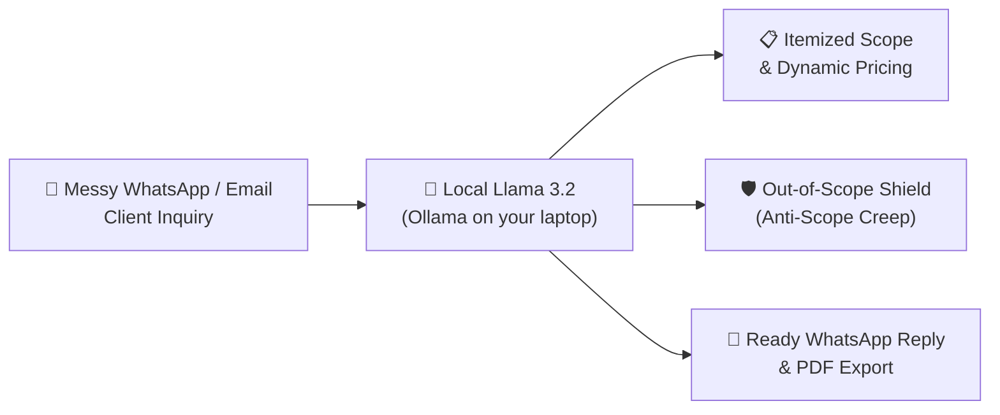

<div align="center">

# 💼 QuoteCraft

**Turn messy client WhatsApp messages into professional quotations, scope-of-work, and ready-to-send replies in seconds.**

*A local, privacy-first AI tool built for freelancers, solo agencies, and small service businesses.*


</div>

---

## 🤔 The Problem

Every freelancer, solo developer, designer, photographer, and local business owner knows this pain:

A client sends a rambling, messy message on WhatsApp or Instagram at 10 PM:
> *"hey bro need website for my bakery in dehradun with online menu, photo gallery, online order enquiry form connected to whatsapp, and google maps location. we have logo ready. how much will this cost and can we get it before diwali? also need 3 revisions and basic seo."*

Responding takes **30 to 60 minutes** of tedious work:
1. Translating messy thoughts into clear deliverables
2. Estimating realistic days and pricing
3. Setting milestones and advance deposit terms
4. **Setting boundaries against scope creep** (so you don't end up doing unpaid extra work!)

Because writing quotes takes so long, freelancers delay replying, lose impatient clients, or give a casual verbal estimate that leads to endless scope creep later.

Existing quoting software (like PandaDoc or HoneyBook) costs **$19 to $49 every single month**, and worse: **pasting confidential client projects, budgets, and phone numbers into cloud AI APIs risks violating client NDAs and privacy.**

---

## 💡 The Solution: QuoteCraft

**QuoteCraft** runs completely on your laptop using a local open-weight model (**Llama 3.2 via Ollama**).

1. **Paste the messy message** (or pick a sample preset).
2. **Click Generate**: In ~15 seconds, local Llama 3.2 extracts:
   - 📌 **Executive Project Summary** (proves you understood their business goal)
   - 📋 **Itemized Scope of Work** (deliverables with estimated days and prices)
   - 🛡️ **Anti-Scope Creep Shield** (strictly lists what is *not* included)
   - 📅 **Phased Milestones & Payment Terms** (advance deposit % and review rounds)
   - 💬 **One-Click WhatsApp Reply** (ready to paste with bold `*text*` and emojis)
   - ✉️ **Formal Email Proposal**
3. **Edit in real-time**: Tweak any deliverable, price, or timeline; the total recalculates instantly.
4. **Send or Print**: Copy to WhatsApp in one tap, or print / save as a clean PDF quotation sheet!

---

## ⚙️ How It Works



| Step | What happens | Powered by |
|---|---|---|
| **Input** | Paste client inquiry, choose currency (₹, $, €, £) & tier | Local browser web UI |
| **Analysis** | Extracts deliverables, risks, timeline & cost items | **Llama 3.2 (3B)** via local Ollama |
| **Output** | Interactive table, auto-recalculating totals, out-of-scope list | Vanilla JavaScript + HTML5 |
| **Export** | 1-click WhatsApp copy, email markdown, or PDF print | Modern browser clipboard & print CSS |
| **History** | Keeps a private offline log of all your quotes | Local `quotes.json` |

---

## 🚀 Quickstart

### Prerequisites
- Python 3.10+
- [Ollama](https://ollama.ai) installed with `llama3.2`:
  ```bash
  ollama pull llama3.2
  ollama serve
  ```

### Run QuoteCraft
1. Clone the repo and install dependencies:
   ```bash
   git clone https://github.com/VIKRAM-009/quotecraft.git
   cd quotecraft
   pip install -r requirements.txt
   ```

2. Start the web app:
   ```bash
   python3 app.py
   ```

3. Open `http://localhost:5000` in your browser.

---

## 🌟 Why Open Innovation Matters

For a micro-business or freelancer tool, open-weight models are not just an alternative — **they make the business model work**:

1. **100% Client Confidentiality & Privacy**:
   Freelancers frequently work under non-disclosure agreements (NDAs) or handle unpublished business ideas, customer lists, and financial figures. With local open-weight AI, **zero bytes leave your laptop**. No data is logged on a corporate cloud server or used for model training.

2. **Zero Recurring API Costs ($0.00 / month)**:
   Closed SaaS wrappers charge \$20–\$50/month, and API keys charge per million tokens. For a freelancer in India or anywhere starting out, high monthly software fees eat into small margins. Running Llama 3.2 locally costs **\$0.00**, whether you quote 5 projects or 500 projects.

3. **Works Anywhere, Even Offline**:
   Whether you are traveling on a train, working from a café with spotty internet, or in an area with power cuts, QuoteCraft works 100% offline.

4. **No Vendor Lock-in or Sudden Price Hikes**:
   Closed API providers can change pricing, throttle rate limits, or deprecate models without warning. Open models belong to the community and can be run indefinitely.

---

## 📄 License

MIT License. Built for Hacktoberfest 2026 (DEV Challenge Week 2: "Side Hustle").

